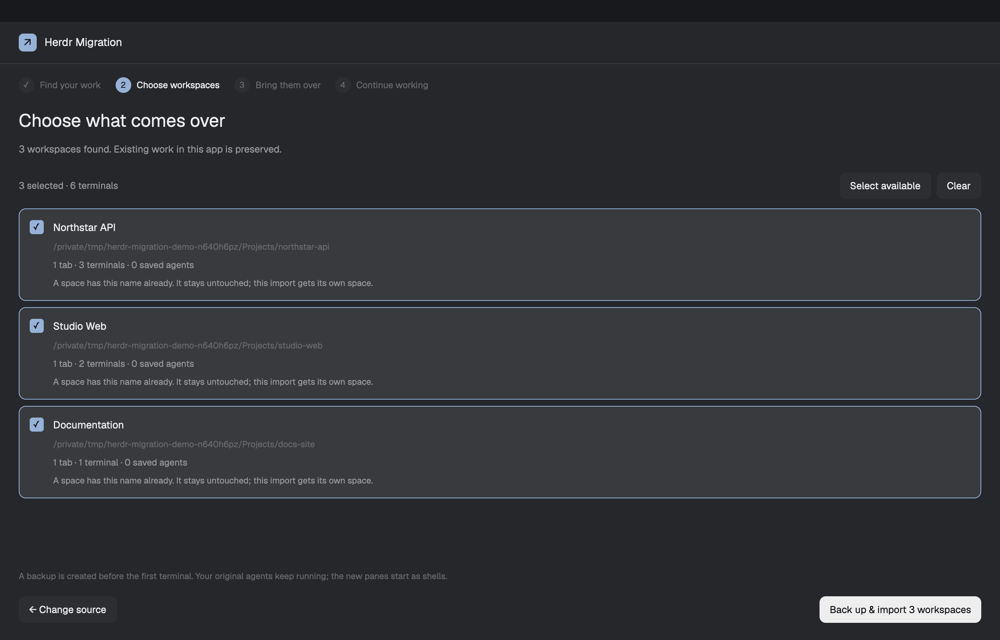

# Herdr Migration

**Bring the work you already organized into the new Herdr app.**

[](https://github.com/CiprianSpiridon/herdr-migration/actions/workflows/tests.yml)
[](LICENSE)



Moving from Herdr TUI to the native desktop app? This mod brings over your workspaces, tabs, working folders and terminal splits. You choose what to import, get a backup first, and can see when every folder and split has been verified.

Your agents keep running in classic Herdr while you move. When you're ready, exit an old agent and use **Resume** to open its saved conversation in the new app.

*The screenshot shows the real native mod with sample projects in an isolated Herdr session.*

## Install

Paste this into an agent running in Herdr:

```text
Read ~/.config/herdr-app/AGENTS.md, then add and open this mod: github.com/CiprianSpiridon/herdr-migration
```

Your agent reads [RECIPE.md](RECIPE.md) and the mod's files, copies `mods/herdr-migration/` into your Herdr app folder, merges the available shortcuts, checks the mod and opens the wizard. It keeps your existing layout and key bindings.

After installation, open it with **⌘⇧M** on macOS or **Ctrl+Shift+M** on Linux and Windows.

You need [Herdr desktop and herdr-core](https://herdr.dev/), Python 3.10 or newer, and a classic Herdr session on the same computer. The mod detects `python3`, `python` or the Windows Python launcher.

<details>
<summary>Install manually</summary>

The optional installer checks the mod, preserves existing files and adds available shortcuts:

```sh
git clone https://github.com/CiprianSpiridon/herdr-migration.git
cd herdr-migration
python3 install.py
herdr-app do mod.open --name herdr-migration
```

On Windows, use `py -3 install.py` if Python is installed through the Python launcher.

If a shortcut is already in use, it stays yours. Open the mod through Herdr's command palette or the `mod.open` command instead.

</details>

## Four steps, with a clear stopping point

**1. Find your work.** Use the default classic session or choose a named session's folder or saved `session.json`. Scanning creates a preview without opening terminals.

**2. Choose your workspaces.** Select the projects you want. The preview shows tabs, terminal counts, saved agents, missing folders and name collisions. Previously imported spaces are recognized and left alone.

**3. Bring them over.** A local backup is saved before the first terminal is created. The import runs in the background, restores the split proportions and verifies the result. You can close the dialog or pause the import and continue later.

**4. Continue working.** Open the imported spaces. When an agent is no longer open in classic Herdr, resume its conversation from the wizard. If its exact session ID is unavailable, its own resume picker lets you choose.

## What comes with you

| Your classic setup | In the desktop app |
| --- | --- |
| Workspaces and their names | New spaces |
| Tabs and their names | Tabs in the matching space |
| Each terminal's working folder | A shell in that folder |
| Horizontal and vertical splits | The same arrangement and proportions |
| Saved Claude, Codex and Grok conversations | A separate, guarded resume step |
| Running agents | Keep running in classic until you choose to leave them |

Classic plugins, themes, key bindings and SSH machine profiles are not converted. Add remote machines through Herdr's own settings. This mod imports local workspace organization; it cannot move a live process between the two runtimes.

## If something interrupts the move

Reopen the wizard. **Continue import** recovers the saved run and finds terminals already created by that import, including a terminal created just before a connection dropped. It does not start another copy of them.

Missing folders are called out before import. A changed source requires another preview. Changes to other app spaces are merged rather than replaced. Corrupt migration history is kept for investigation instead of silently discarded.

Backups and migration history stay on your computer under:

```text
~/.config/herdr-app/data/herdr-migration/
```

The completion screen shows the exact backup location. Backups include the classic session, the app's versioned layout document, and available settings, keys and view files. Restoring a whole backup over newer work is a manual operation; this mod does not remove imported spaces or stop their terminals for you.

## Local files, local controls

The mod runs the installed `herdr`, `herdr-app` and `hc` commands through a small Python helper. It reads the selected classic session and app configuration, then writes private migration history and backups. It does not read credential stores or terminal scrollback, send telemetry, or make HTTP requests.

Conversation resumes are checked again at the moment you click: the old session must be closed and the destination must be an available shell. The agent opens in a new tab with its native arguments. Complete any sign-in, trust or approval prompt there yourself.

## Rebuild it, change it, share it

[RECIPE.md](RECIPE.md) is the rebuild brief: enough for another agent to make this mod from an empty folder. The files here are one implementation of that brief.

```text
herdr-migration/
├── mods/herdr-migration/
│   ├── main.js         Native GPUI wizard
│   ├── backend.py      Import, recovery and verification
│   ├── mod.json        Dialog dimensions
│   └── spinner.svg     Native progress animation
├── keys.json           Optional shortcut snippet
├── RECIPE.md           The rebuild brief
├── preview.png         Actual native UI screenshot
├── install.py          Installer that preserves existing files
└── tests/              Recovery and safety regressions
```

There is no `layouts/` folder. The package follows [Herdr's mod-sharing format](https://herdr.dev/mods/) and uses the `herdr-mod` repository topic.

## Development

```sh
python3 -m unittest discover -s tests -v
herdr-app check mods/herdr-migration
```

Native UI and a complete import are verified on macOS with Herdr app 0.1.9 and herdr-core 0.1.14. The backend uses Python's standard library; automated backend tests also run on Linux and Windows. No package installation is needed.

MIT licensed. Built by [Ciprian Spiridon](https://github.com/CiprianSpiridon). This is a community mod, independent of the Herdr project.
