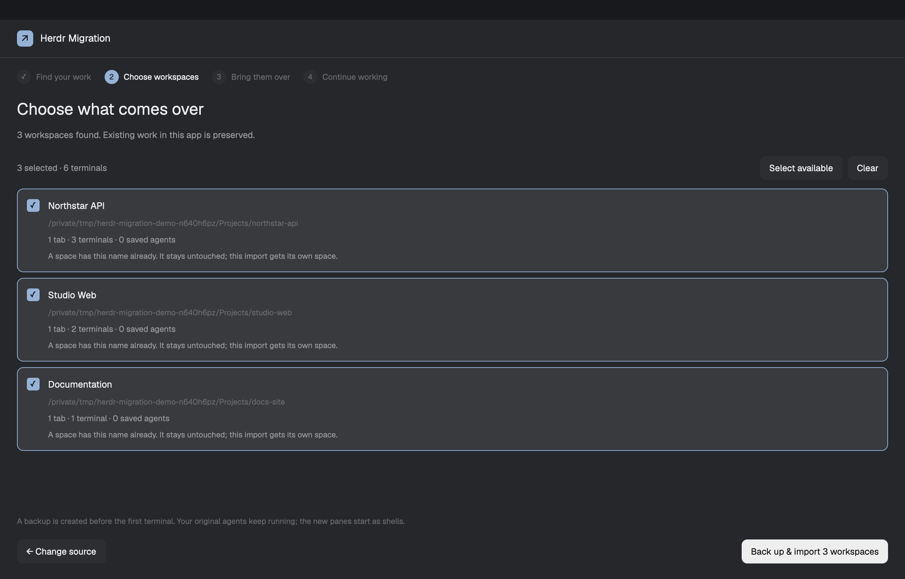

# Herdr Migration

A native, four-step migration wizard for people moving from classic Herdr TUI to the Herdr desktop app. It finds a classic session, previews the workspaces, imports the chosen terminal organization with a backup and verification, then helps people resume conversations when their original agents are closed. The existing app layout and live agents stay available throughout.

## What you see

Open a 900 × 720 logical-pixel dialog. Use the user's Herdr theme throughout: `popover` for its background, `surface` for cards, `raised` for secondary controls, `foreground`/`muted`/`dim` for text, and `accent` for selection. Use the theme's `solid` and `solid_foreground` for primary buttons. No hardcoded light/dark palette.

From top to bottom:

1. A 54px header, with 24px horizontal padding, a 23px accent square containing an up-right arrow, **Herdr Migration** in 14px semibold, and Close on the right when opened as a dialog.
2. A horizontal step strip with 20px numbered circles and 11.5px labels: **Find your work**, **Choose workspaces**, **Bring them over**, **Continue working**. The active circle is accent; earlier circles show a check. Leave 18px between steps.
3. The flexible body, padded 24px horizontally and 22px below. Page headings are 23px semibold; explanatory text is 12.5px. Keep action labels at 12.5px and secondary details around 11–11.5px.
4. An inline error card in the theme's blocked color when needed; an optional notice along the bottom. Errors remain visible beside a practical next action.

The four pages:

- **Find:** “Bring your work to Herdr”, three equal cards for Preview first / Backed up / Keep working, an editable classic-session path with Choose folder, a short description of what comes over, and Find my workspaces. The default path is the user's `~/.config/herdr/session.json`.
- **Choose:** a count of workspaces and selected terminals, Select available / Clear, a scrolling list, and Change source / Back up & import. Each row has an 18px checkbox, project name, folder, tab/terminal/agent counts and any Already imported or Folder missing badge. Selected rows use `selected` and an accent border. Cards use 13px padding, 12px gaps and 9px corners. A name collision explains that the existing space is preserved and the import gets a separate space.
- **Import:** a progress card with a native 20px rotating arc, a sentence describing the current operation, a 6px progress bar, created/total count, percent and backup status. The normal action is Pause import. An interrupted run changes the heading to “Pick up where you left off” and offers Continue import.
- **Continue:** “Your workspaces are ready”, a Verified badge and terminal count, conversation rows, the exact backup location, Import another session and Done. Each conversation row names the workspace and agent, shows its actual classic status and offers Resume only when its old instance is no longer open.

## How it behaves

Scanning reads the selected session and checks the running app. It opens no terminals. Accept either a session file or its containing folder. Choose folder uses the native folder picker. Named classic sessions are recognized when their folder matches the classic CLI's session inventory.

Select all available workspaces initially. Missing-folder and already-imported rows cannot be selected. Individual rows toggle on click; Clear empties the selection; the import button is disabled with no selection. If a selected source changes structurally after preview, require a new scan. A focus/sidebar bookkeeping change alone does not invalidate it.

Back up before creating any terminal. Run the import outside the view's lifetime: closing the dialog leaves it running. Poll progress once per second while importing, and every 15 seconds while idle. Reopening restores the previous run. Pause stops at a terminal boundary, retains created work and offers Continue import. Continuing recovers existing terminals by migration labels, including a successful spawn whose response was lost.

Create local shells in each original folder. Restore the complete row/column split tree and its proportions. Verify folders, liveness, core keep, pane identities and the versioned layout document before reporting success. Preserve unrelated app spaces, including ones created concurrently. Repeated scans recognize verified imports. A deleted destination can be reimported only when its old imported terminals are no longer live.

The conversation statuses are real metadata from the matching classic server:

- **working:** working color, “Working in classic”; no Resume button.
- **blocked:** blocked color, “Needs you in classic”; no Resume button. Never answer its approval or question.
- **done:** done color, “Done in classic”; still no Resume while its old process exists.
- **idle:** muted, “Open in classic”; still no Resume while its old process exists.
- **unknown:** muted, “Open in classic”; do not infer completion.
- **unavailable:** muted, “Classic status unavailable”; refuse resume because the source cannot be checked.
- **background:** working color, “Running as a Claude background session”; no Resume button. `claude agents --json` lists the session as `kind: background`. This happens after Claude's “Move to background and exit”: the classic pane closes, but the conversation keeps running.
- **elsewhere:** muted, “Open in another Claude session”; `claude agents --json` lists it as interactive somewhere else. No Resume button.
- **unchecked:** muted, “Can't check Claude's sessions”; `claude agents --json` failed. Refuse resume until it works.
- **ready:** “Ready to resume”, with Resume. Check again on click for the same session anywhere in classic Herdr and, for Claude, in `claude agents --json`. Also check that no agent is running in the imported terminal: none reports a status, and none of `claude`, `codex` or `grok` is its foreground argv. Any other foreground, including a shell wrapped by a recorder or multiplexer, is fine because Resume opens its own tab.
- **resumed:** done color and “Resumed” once the agent is seen running in its new tab. That proves the launch, not that sign-in or trust prompts are finished.
- **failed:** blocked color, “Launch failed”, with Resume again. The new tab didn't run the agent within 8 seconds, usually because a shell profile wrapped or replaced the shell first. Leave the tab open. On the next click, if the agent has started there since, adopt that tab instead of launching again.

Claude, Codex and Grok use exact native session IDs when available; otherwise open their own resume picker. Other agents require manual startup. Resume launches native argv in a new tab, selects it, focuses its terminal and closes the dialog so the person can complete any agent prompt. With two or more ready rows, **Resume all ready** resumes them one at a time, each with the same checks. It keeps the dialog open with a running count and stops at the first refusal or failed launch. Never inject a command into a potentially edited shell prompt, stop an existing agent or bypass permissions.

Buttons darken or fade slightly on hover. The arc uses native `.spin(1000)`, never animation timers. Close dismisses the dialog; Done does the same. The wizard is scrollable where lists grow. It does not move or replace the person's layout. Shortcut: Cmd+Shift+M on macOS, Ctrl+Shift+M elsewhere; both open the mod. Preserve a conflicting existing shortcut.

## Built from

Ship one folder with `mods/herdr-migration/`, `keys.json`, this recipe and `preview.png`. Do not ship `layouts/`.

The main install flow is one request to the person's Herdr agent: `Read ~/.config/herdr-app/AGENTS.md, then add and open this mod: github.com/CiprianSpiridon/herdr-migration`. The agent reads the recipe and every mod file, copies the mod folder, merges only available shortcuts, runs the check and opens the wizard. Copying the mod folder is sufficient; `install.py` is an optional convenience for manual installation. Python 3.10 or newer is still required for the backend.

- `main.js`: a `View` from `gpui-kit`; chained `div`, `h_flex`, `v_flex`, `InputState`/`Input` from `gpui-base`. Its node tree is a column containing the header, step row, flexible page body and notice. It uses `theme`, `appHome`, `home`, `exec`, `pickFolder`, `props`, `closeOverlay`, `run` and `nextCommand` from `herdr`. No shipped mod is required. Optional `props.source` sets the initial source path for embeddings; normal use needs no props.
- `mod.json`: `place: "none"`; overlay width 900, height 720. Open with `mod.open {name: "herdr-migration"}`. No layout is installed.
- `spinner.svg`: a 24px open circular arc, one color, tinted by the theme and rotated natively. The arrow and checkbox check are text.
- `backend.py`: Python 3.10+, standard library only. The view probes `python3`, `python3.14` down to `python3.10`, Homebrew's `python3`, `python` and Windows' `py -3`. It uses the first that reports 3.10 or newer, so an older system `python3` earlier on `PATH` is skipped. It invokes commands with explicit app-home arguments. The backend also refuses to run on an older Python. Its commands are scan, start, status, pause, retry, worker and resume. Long imports run in a detached worker because Herdr's `exec` calls have a time limit.
- `install.py`: checks the mod, installs it only when the destination is absent or identical, merges only unclaimed shortcut bindings and preserves the original keys file. It installs no layout.

The helper reads the chosen `session.json`, normalizes workspace/tab/pane data and validates each split. For a matching live classic session, `herdr session list --json`, `herdr api snapshot` and `herdr agent list` supply names, live folders, agent states and saved session IDs. Named-session commands use the explicit matching `--session` selector.

For the desktop app, use the installed `hc connect` JSON-RPC API. Read the `herdr-app` document with `doc.get`. Create shells using `terminal.run {cwd, keep: true, no_parent: true, no_notify: true, labels}`. Labels include `herdr.space`, `herdr.tab`, `herdr-migration.source` and `herdr-migration.pane`; the last two make interrupted work recoverable. Generate destination IDs once, journal them before spawning, and preserve that mapping across retries.

After creation, merge only the imported space IDs into the newest document. Use `doc.set` with its matching version; on a version conflict, reread and merge rather than overwrite another edit. Verify with `doc.get` and `terminal.list`. Resume uses `terminal.get`, the classic agent inventory and, for Claude, `claude agents --json` (match `sessionId`). It then runs `herdr-app do tab.new {space, folder, name, argv}`. Codex includes `--no-daemon`. Journal the launch before verifying it. Then poll `terminal.get` on the new terminal until a status is reported or the agent is its foreground argv. Claude's process name is its version number, so match argv, not the name.

Store state under `<appHome>/data/herdr-migration/`, with one source identity per canonical session path. Use atomic JSON replacements and an exclusive operation lock. Each run keeps its immutable preview, backup, worker log and verified receipt. The backup includes the classic session, app layout document and available settings/keys/view JSON. Keep files private where the OS supports permissions.

This mod runs programs and reads files outside its own mod folder. It uses only the local Herdr CLIs and explicitly selected session/app configuration. It does not read terminal scrollback, credential stores or transcripts, and makes no HTTP requests. Agent launches happen only when the person chooses Resume.

## Watch out

- Classic Herdr and herdr-core own different processes. Recreating a pane cannot move its running agent. Keep the live process in classic and make conversation handoff explicit.
- Import is for local workspaces on the same computer. It does not convert classic plugins, themes, key bindings or SSH profiles. Missing local paths must be restored or deselected; there is no path-remapping screen.
- `tab.new` runs argv through the person's interactive shell (`zsh -lic '"$@"; exec "$0" -li'`). A profile that wraps or `exec`s interactive shells, such as a terminal recorder, auto-started tmux or `exec fish`, takes over the tab before argv runs. So a new tab is not a launch, and a wrapper process in the imported terminal is not a busy terminal. The README shows the `$ZSH_EXECUTION_STRING` guard.
- Claude's “Move to background and exit” keeps a conversation running with no classic pane. The classic agent list misses it; `claude agents --json` does not.
- Agent resume is implemented for Claude, Codex and Grok. An exact ID may be absent, especially in an exported or offline session; use the agent's picker instead of guessing a conversation. The matching classic server must remain reachable for duplicate-session checks.
- Core document persistence and app adoption are asynchronous. Use versioned writes and bounded retry; a CLI success alone is not verification. Core marker labels must be attached atomically when starting a terminal so a lost reply cannot cause a duplicate on retry.
- Do not retain a view `cx` across callbacks. Each timer, spawned task and input handler uses its own context. Closing a view must not cancel the detached worker.
- Do not use `os.kill(pid, 0)` to check a worker on Windows; it can terminate the process. Use process-query APIs there. On Unix, use a liveness check only; never signal the person's app or core.
- Reject malformed trees, duplicate panes, non-finite proportions, source files above 16 MiB, more than 200 workspaces or more than 1,000 panes. Corrupt history is an error, not permission to start empty.
- No automatic rollback removes imported terminals. The backup path is visible, and restoration is manual to avoid destroying work started after import. A new agent tab can still need its own sign-in, trust or approval.
- `preview.png` must be a screenshot of the actual mod with anonymous sample projects, never a capture of private terminal work. The sample screenshot may use a temporary host layout for QA; that layout is not part of the shared mod package.

## Done when

- `herdr-app check mods/herdr-migration` passes, and the actual running dialog renders all four pages without errors.
- A real isolated import creates the selected workspaces, tabs and split shells, preserves an existing unrelated space, verifies every working folder and restores the source proportions.
- Rescanning that import marks it Already imported and does not create duplicates.
- A successful spawn followed by a simulated lost reply is recovered by labels on retry, without another terminal.
- Tests cover missing folders, changed previews, malformed splits, pause/continue, concurrent document edits, duplicate resumes, live Claude background sessions, busy and wrapped destinations, hijacked and late launches, unreachable classic servers and corrupt journals.
- Backups exist before the first spawn, remain on the local machine and have a visible location after completion.
- The public repository contains this recipe, `preview.png`, `mods/herdr-migration/` and the key snippet, has no `layouts/` folder or personal runtime data, and has the `herdr-mod` topic.
